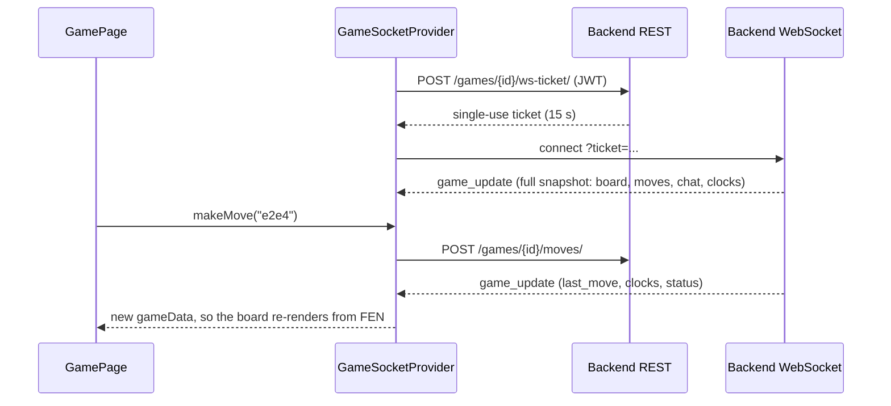

# Knightmare — Frontend

React client for Knightmare, a real-time multiplayer chess app with chess clocks, in-game chat and a peer-to-peer video call.

**Live demo:** https://knightmare-9qwrr0.web.app  ·  **Backend repo (architecture, API, scaling):** [knightmare-backend](https://github.com/hardik-maheshwari/knightmare-backend)

## Features

- Create a game and share its ID or link; the opponent joins from the lobby (a pasted link works too)
- Live board sync over WebSockets, with a board that flips for Black, legal-move hints and auto-queen promotion
- 3+0 chess clocks driven by the server's clock anchor
- In-game chat with history
- Video call between the two players (WebRTC via PeerJS)
- Resignation, timeout detection and a game-over modal
- JWT login, with protected routes and public-only routes

## Tech stack

React 19 · Vite · React Router 7 · axios · chess.js · PeerJS · plain JavaScript · deployed on Firebase Hosting

## How it talks to the backend

**Actions go over REST and state comes back over the WebSocket.** The client never applies a move to its own board. It sends the move, and the board changes when the server broadcasts the committed result. chess.js runs locally only to highlight legal moves.



- **Why a ticket:** browsers can't send an `Authorization` header on a WebSocket, and a JWT in the URL would end up in logs. So the client trades its JWT for a short-lived, single-use ticket first.
- **Reconnects:** if the socket drops unexpectedly, it reconnects after 3 seconds with a fresh ticket. It doesn't retry on close code 1008 (auth rejected).

## Structure

| Piece | Role |
|---|---|
| `context/AuthContext.jsx` | Holds the JWT (stored in `localStorage`), verifies it on load via `/auth/profile/`, and attaches it to every axios request with an interceptor |
| `components/ProtectedRoute.jsx` | `AuthGateway` (redirects `/`), `ProtectedRoute` (logged-in only) and `PublicRoute` (logged-out only) |
| `context/GameSocket.jsx` | Per-game provider: ticket and WebSocket lifecycle, reconnects, merging `game_update` events into `gameData`, chat messages, WebRTC signals, plus the actions (move, chat, resign, claim timeout) |
| `hooks/useChessGame.js` | Board interaction: select a piece, show legal targets, detect promotion, send the move |
| `components/ChessClock.jsx` | Shows remaining time computed from the server's `*_time_ms` and `last_move_at`. At zero it asks the server to check the timeout; the server decides. |
| `components/VideoChat.jsx` | Camera/mic, a PeerJS peer, publishing its peer ID through the backend `/signal/` route and calling the opponent's ID |
| `pages/` | Login, Register, Profile, Lobby (create/join), Game |

Routes: `/login`, `/register`, `/profile`, `/lobby`, `/game/:gameId`.

## Running locally

Requires Node 20+ and the [backend](https://github.com/hardik-maheshwari/knightmare-backend) running on `localhost:8080`.

```bash
npm install
npm run dev          # http://localhost:5173
```

Leave `VITE_BACKEND_URL` unset locally: the Vite dev server proxies `/api`, including WebSockets, to `localhost:8080`.

## Deployment

The build is static and hosted on Firebase Hosting. `firebase.json` adds an SPA rewrite, so deep links like `/game/<id>` work, and caches hashed assets long-term while never caching `index.html`. The backend URL is baked in at build time:

```bash
VITE_BACKEND_URL=https://<cloud-run-backend-url> npm run build
firebase deploy --only hosting
```

The backend must list this site's origin in `CORS_ALLOW_ORIGINS`.

## Known limitations

- **Promotion always makes a queen.** There's no piece picker yet.
- **No takeback UI.** The backend supports the request/accept handshake, but it isn't wired into the client yet.
- **Video uses PeerJS's public broker.** The backend only exchanges peer IDs between the two players. Connection setup goes through PeerJS's cloud server and STUN only, with no TURN relay, so some strict NATs can't connect.
- **The clock display trusts the local system clock.** A skewed device clock shows the wrong time, but the server still decides any timeout.
- **The JWT is in `localStorage`.** That's simple, but readable by any script on the page; an httpOnly cookie would be safer.
- **No TypeScript and no tests yet,** and debug logging isn't gated behind a dev flag.

## License

MIT, see [LICENSE](LICENSE).
